# Single-scale three-loop massless integrals

Two Mathematica files, both in the convention of eq. (3.1) of
[arXiv:2410.19088](https://arxiv.org/abs/2410.19088) (the one used for family H):

```
I = (-q^2)^(3ε) e^(3εγ_E) ∫ ∏_l d^dk_l/(iπ^(d/2)) ∏_i 1/(P_i)^(ν_i),   P_i = -(momentum)^2,   d = 4 - 2ε,
```

evaluated at −q² = 1 (Euclidean region; same normalisation as `H/results/planarInsertedXY.m`).

| file | content |
|---|---|
| `SingleScale3L.wl` | Γ-function building blocks for any indices (`GOne`, `Banana`, `OnShellTriangle`, `ReduceGamma`), and `HSingleScale`: the 12 single-scale masters of family H |
| `FormFactorMasters3L.wl` | `FFMasters`: all 24 master integrals of the massless three-loop form factor (q² off-shell, p₁² = p₂² = 0) up to weight 8, plus the non-planar propagator B₈,₁ up to weight 10 |
| `figures/` | one graph per integral (SVG) |

Neither `.wl` file has been loaded in a Wolfram kernel yet; all numbers were checked in Python (see *Checks*).

## Conversion between conventions

With N the sum of propagator powers:

* Lee–Smirnov (propagators 1/(k²+i0), `e^{-3γ_E ε}` written out): I = (−1)^N e^{3εγ_E} I_LS
* Gehrmann et al. (S_Γ normalisation): I = e^{3εγ_E} X_GGHIS / Γ(1−ε)³

## Form-factor masters (`FormFactorMasters3L.wl`)

Names are those of [LS11]. The second column gives the [GGHIS10] name, whose figure is shown. In each figure, q enters on the left, p₁ exits at the top and p₂ at the bottom; a broken line marks a crossing (non-planar).

| LS11 name | GGHIS10 | graph | N | | closed form | expanded to | references |
|---|---|---|---|---|---|---|---|
| A4 | B₄,₁ |  | 4 | planar | Γ | ε⁷ (weight 8) | Chetyrkin-Tkachov81, MINCER, Bekavac05, GGHIS10, LS11 |
| A5,3 | B₅,₁ | 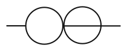 | 5 | planar | Γ | weight 8 | Chetyrkin-Tkachov81, MINCER, Bekavac05, GGHIS10, LS11 |
| A5,4 | B₅,₂ |  | 5 | planar | Γ | weight 8 | Chetyrkin-Tkachov81, MINCER, Bekavac05, GGHIS10, LS11 |
| A6,6 | B₆,₁ |  | 6 | planar | Γ | weight 8 | Chetyrkin-Tkachov81, MINCER, Bekavac05, GGHIS10, LS11 |
| A6,4 | B₆,₂ | 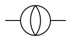 | 6 | planar | – | ε⁵ (weight 8) | Chetyrkin-Tkachov81, MINCER, Bekavac05, GGHIS10, LS11 |
| A6,4^d | B₆,₂ with one dot (UT) |  | 7 | planar | – | weight 8 | LS11 |
| A6,5 | C₆,₁ | 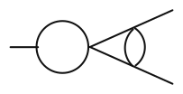 | 6 | planar | Γ | weight 8 | GGHIS10, LS11 |
| A5,1 | A₅,₁ | 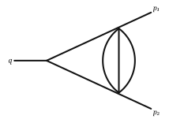 | 5 | planar | Γ (any indices) | weight 8 | GHHS06, LS11 |
| A5,2 | A₅,₂ | 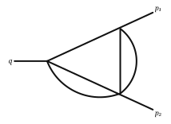 | 5 | planar | Γ (any indices) | weight 8 | GHHS06, LS11 |
| A6,1 | A₆,₁ | 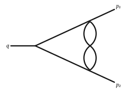 | 6 | planar | Γ (any indices) | weight 8 | GHHS06, LS11 |
| A6,2 | A₆,₂ | 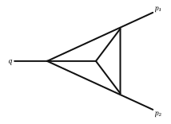 | 6 | planar | – | weight 8 | HHM08, GGHIS10, LS11 |
| A6,3 | A₆,₃ | 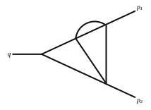 | 6 | planar | ₃F₂ | weight 8 | GHHS06, LS11 |
| A7,1 | A₇,₁ | 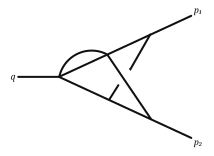 | 7 | **non-planar** | ₄F₃/₅F₄ | weight 8 | GHHS06, LS11 |
| A7,2 | A₇,₂ | 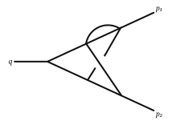 | 7 | **non-planar** | hypergeometric | weight 8 | GHHS06, LS11 |
| A7,3 | A₇,₃ | 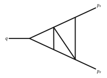 | 7 | planar | – | weight 8 | HHM08, GGHIS10, LS11 |
| A7,4 | A₇,₄ | 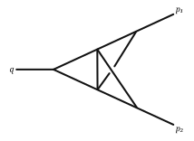 | 7 | **non-planar** | – | weight 8 | HHM08, GGHIS10, LS11 |
| A7,5 | A₇,₅ | 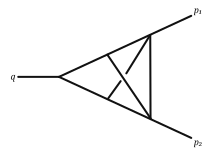 | 7 | **non-planar** | – | weight 8 | HHM08, GGHIS10, LS11 |
| A8 | A₈,₁ | 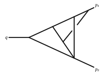 | 8 | **non-planar** | – | weight 8 | HHM08, GGHIS10, LS11 |
| A9,1 (and UT A9,1^n) | A₉,₁ | 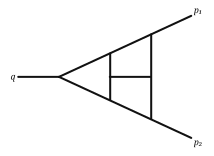 | 9 | planar | – | weight 8 | HHKS09, LSS10, GGHIS10, LS11 |
| A9,2 (and UT A9,2^n) | A₉,₂ | 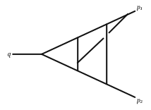 | 9 | **non-planar** | – | weight 8 | HHKS09, LSS10a, GGHIS10, LS11 |
| A9,4 (and UT A9,4^n) | A₉,₄ | 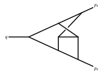 | 9 | **non-planar** | – | weight 8 | HHKS09, LSS10a, GGHIS10, LS11 |
| B8,1 | B₈,₁ |  | 8 | **non-planar** propagator | – | **weight 10** | CKT80, Kazakov84, Bekavac05, LSS10, GGHIS10 |

For the UT versions A9,1^n, A9,2^n and A9,4^n, the numerators are those defined in HHKS09. Only their denominators were converted with (−1)^9 here, so check the numerator sign convention there before using them.

Constants: ζₙ, and the double sums MZV[m₁,m₂] = Σ_{i>j≥1} sgn(m₁)^i sgn(m₂)^j /(i^|m₁| j^|m₂|) (the definition of LS11). Weight 8 needs ζ₋₆,₋₂ ≈ −0.0147685732756666558 (computed here to about 20 digits), and B₈,₁ also needs ζ₅,₃ and ζ₈,₂.

## Family H single-scale masters (`HSingleScale` in `SingleScale3L.wl`)

Each family-H element equals scale^(−3ε) × C(ε). The graphs below are reconstructed from momentum conservation. Line labels are the propagator numbers of `H/input/props.m`, and a dot marks a squared propagator.

| basis # | graph | scale | status |
|---|---|---|---|
| 1, 2, 3, 4 | 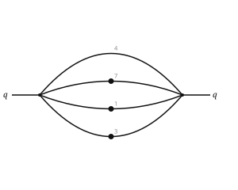 | m², s₁₂, s₂₃, s₁₃ | Γ closed form (= eq. 3.4 of 1306.2799), weight 8 |
| 17, 18 | 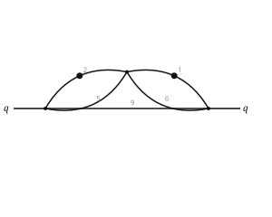 | s₁₂, s₁₃ | Γ closed form (same graph as A5,4/B₅,₂), weight 8 |
| 23, 58 | 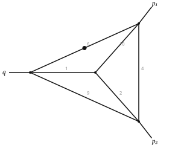 | s₁₃, s₁₂ | graph of A₆,₂ but with a dot; values to weight 6 (H pipeline) |
| 67, 74 | 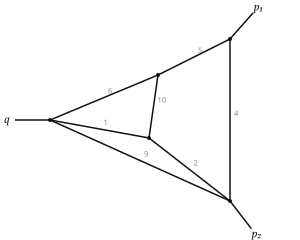 | s₁₃, s₁₂ | planar; same graph as A₇,₅ but with the external legs elsewhere; values to weight 6 |
| 169, 170 | 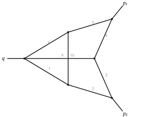 | s₁₂, s₁₃ | **non-planar**, not one of the masters above; values to weight 6 (169 agrees with AMFlow to 39 digits) |

For 23/58, 67/74 and 169/170, the weight-7 and weight-8 terms need an IBP reduction onto `FormFactorMasters3L.wl`, or the H pipeline run to weight 8.

## Provenance: literature vs. computed here

### Taken from the literature (only converted to the convention above)

| what | source |
|---|---|
| All 24 form-factor masters in `FormFactorMasters3L.wl`, weights 0–8, including closed Γ forms | LS11 (weight 8), GGHIS10 (weight 6), GHHS06/HHM08/HHKS09/LSS10a (first evaluations) |
| B₈,₁, weights 5–10 | CKT80, Kazakov84, Bekavac05, LSS10 |
| Family H 1–4 (banana): closed form and expansion to ε⁶ | eq. (3.4) of arXiv:1306.2799 |
| Γ building blocks `GOne`, `Banana`, `OnShellTriangle` (any indices) | standard one-loop G-functions; on-shell triangle as in GHHS06 |

### Computed or derived here

| what | how | checked against |
|---|---|---|
| Conversion of all literature results to eq. (3.1) of 2410.19088: I = (−1)^N e^{3εγ} I_LS = e^{3εγ} X_GGHIS/Γ(1−ε)³ | derived; re-expanded LS11 series in this normalisation | LS11 vs GGHIS10 at all common orders; closed Γ forms; family H element 1 |
| Family H 1–4: ε⁷, ε⁸ terms | expanded from the closed form | — (closed form exact) |
| Family H 17/18 (dotted bubble-in-bubble): closed Γ form and expansion to ε⁸ | derived with iterated G-functions (`ReduceGamma`) | H pipeline, weights 0–6 |
| `ReduceGamma` (series/parallel reduction to Γ functions) | written here | banana, element 17, GHHS06 A₅,₁ |
| Numerical value of ζ₋₆,₋₂ | nested sum, ~20 digits | — |
| Graph of every integral, family-H graph reconstruction, LS11 ↔ GGHIS10 name matching | from the figure files / momentum conservation / numerical matching | GGHIS10 figures |

### Not new: from your own H pipeline

These are the family H 23/58, 67/74, 169/170 values at weights 0–6. Element 169 was compared with `H/amflow_solution.m` and agrees to 39 digits. Their weight 7–8 terms are not available yet; they need an IBP reduction onto the masters.

## Checks


All checks were done in Python with mpmath, at 30–40 digits.

* **Transcription:** the expansions were converted to Mathematica automatically from the LaTeX/FORM sources of arXiv:1004.3653 and arXiv:1010.1334 and compared to them by hash, so nothing was retyped.
* **Closed forms:** each closed Γ form equals its expansion at every order given.
* **LS11 vs GGHIS10:** identical at every order both papers give, for all 20 integrals they share, with relative sign (−1)^N as expected.
* **B₈,₁:** LSS10 agrees with GGHIS10 at ε⁰–ε².
* **Family H:** elements 1–4 and 17/18 reproduce `H/solutions/eps_sep` at weights 0–6.

## References

* **[CKT80]** K.G. Chetyrkin, A.L. Kataev, F.V. Tkachov, Nucl. Phys. B 174 (1980) 345.
* **[Chetyrkin-Tkachov81]** K.G. Chetyrkin, F.V. Tkachov, Nucl. Phys. B 192 (1981) 159.
* **[Kazakov84]** D.I. Kazakov, Teor. Mat. Fiz. 58 (1984) 343.
* **[MINCER]** S.G. Gorishnii, S.A. Larin, L.R. Surguladze, F.V. Tkachov, Comput. Phys. Commun. 55 (1989) 381; S.A. Larin, F.V. Tkachov, J.A.M. Vermaseren, NIKHEF-H-91-18.
* **[Bekavac05]** S. Bekavac, *Calculation of massless Feynman integrals using harmonic sums*, Comput. Phys. Commun. 175 (2006) 180, [hep-ph/0505174](https://arxiv.org/abs/hep-ph/0505174).
* **[GHHS06]** T. Gehrmann, G. Heinrich, T. Huber, C. Studerus, *Master integrals for massless three-loop form factors: one-loop and two-loop insertions*, Phys. Lett. B 640 (2006) 252, [hep-ph/0607185](https://arxiv.org/abs/hep-ph/0607185).
* **[HHM08]** G. Heinrich, T. Huber, D. Maître, *Master integrals for fermionic contributions to massless three-loop form factors*, Phys. Lett. B 662 (2008) 344, [arXiv:0711.3590](https://arxiv.org/abs/0711.3590).
* **[HHKS09]** G. Heinrich, T. Huber, D.A. Kosower, V.A. Smirnov, *Nine-propagator master integrals for massless three-loop form factors*, Phys. Lett. B 678 (2009) 359, [arXiv:0902.3512](https://arxiv.org/abs/0902.3512).
* **[BCSSS09]** P.A. Baikov, K.G. Chetyrkin, A.V. Smirnov, V.A. Smirnov, M. Steinhauser, *Quark and gluon form factors to three loops*, Phys. Rev. Lett. 102 (2009) 212002, [arXiv:0902.3519](https://arxiv.org/abs/0902.3519).
* **[LSS10a]** R.N. Lee, A.V. Smirnov, V.A. Smirnov, *Analytic results for massless three-loop form factors*, JHEP 1004 (2010) 020, [arXiv:1001.2887](https://arxiv.org/abs/1001.2887).
* **[LSS10]** R.N. Lee, A.V. Smirnov, V.A. Smirnov, *Dimensional recurrence relations: an easy way to evaluate higher orders of expansion in ε*, Nucl. Phys. B Proc. Suppl. 205–206 (2010) 308, [arXiv:1005.0362](https://arxiv.org/abs/1005.0362).
* **[GGHIS10]** T. Gehrmann, E.W.N. Glover, T. Huber, N. Ikizlerli, C. Studerus, *Calculation of the quark and gluon form factors to three loops in QCD*, JHEP 1006 (2010) 094, [arXiv:1004.3653](https://arxiv.org/abs/1004.3653). Graph figures are taken from this paper.
* **[LS11]** R.N. Lee, V.A. Smirnov, *Analytic epsilon expansions of master integrals corresponding to massless three-loop form factors and three-loop g−2 up to four-loop transcendentality weight*, JHEP 02 (2011) 102, [arXiv:1010.1334](https://arxiv.org/abs/1010.1334).
* J.M. Henn, A.V. Smirnov, V.A. Smirnov, [arXiv:1306.2799](https://arxiv.org/abs/1306.2799), eq. (3.4) (the banana in UT normalisation).
* T. Gehrmann, J. Henn, P. Jakubčík, J. Lim, C.C. Mella, N. Syrrakos, L. Tancredi, W.J. Torres Bobadilla, [arXiv:2410.19088](https://arxiv.org/abs/2410.19088), eq. (3.1) (the convention used here).
